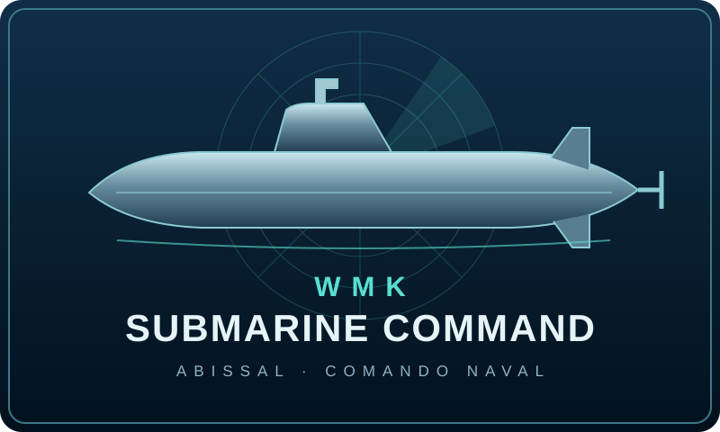

# WMK Submarine Command — Abissal

**Versão 0.3.0 | Simulador naval 3D arcade para navegador**

Comande submarinos fictícios, explore o oceano, realize missões e evolua sua frota. Desenvolvido em HTML5, CSS3, JavaScript e Three.js 0.160.0.

## Recursos
- Porto 3D, hangar, árvore tecnológica e progressão por créditos e XP.
- Nautilus, Manta e Kraken.
- Mergulho e emersão progressivos, bateria e profundidade desejada.
- Academia de treinamento livre, radar tático, sonar e navios em movimento.
- Câmeras externas, torre e periscópio, combate arcade e salvamento local.

## Como executar
Baixe o repositório em Code > Download ZIP, extraia e abra a pasta no VS Code. Execute index.html com Live Server. Alternativamente, execute `python -m http.server 8000` na pasta e abra http://localhost:8000. É necessário acesso à internet para carregar Three.js via CDN.

## Controles
| Tecla | Ação |
|---|---|
| W / S | Acelerar / reduzir |
| A / D | Girar |
| C / X | Emergir / submergir |
| B | Parar |
| R | Sonar |
| M | Mapa tático |
| V | Câmera |
| Tab | Trocar alvo |
| Espaço | Disparar |
| P / Esc | Pausa |
| F1 | Ajuda |

## Documentação
- [Histórico](CHANGELOG.md)
- [Roadmap](ROADMAP.md)
- [Licenciamento](NOTICE.md)

## Estado do projeto
Protótipo em desenvolvimento. Modelos procedurais e parâmetros arcade. Testes de renderização e desempenho em hardware real ainda pendentes.

**Autor do projeto WMK:** Walney Moreira Klein — walneyk@hotmail.com.
